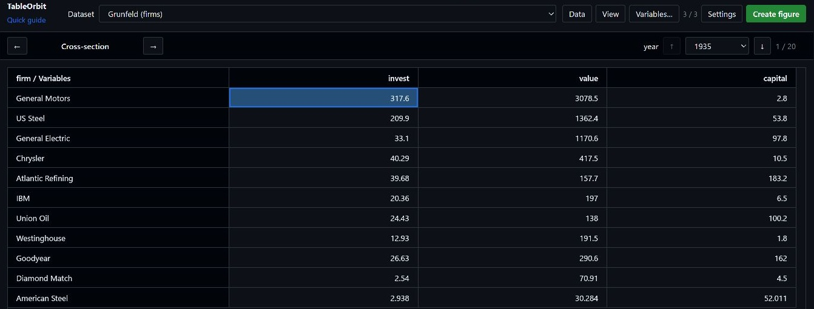
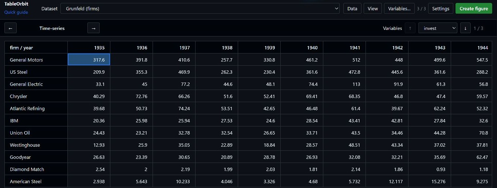
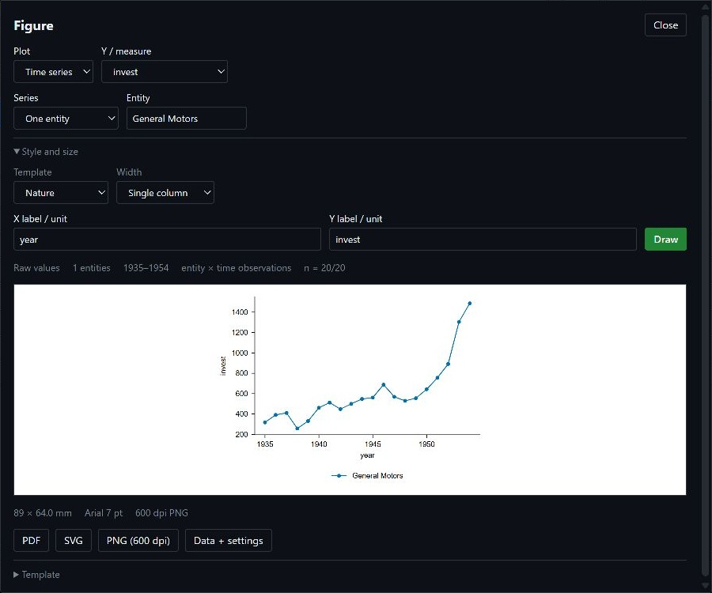

# TableOrbit

Read panel data across entities, time and variables in VS Code.

Switch between a cross-section and a time-series table. Keep the same selected observation when you turn the table. Read large Parquet files through a local query engine.

**Preview 0.2.0.** Install from a VSIX file. TableOrbit is not on the Marketplace. Local installation has been tested on Windows.

## Install in VS Code

1. [Build a VSIX](docs/RELEASE.md#build-a-vsix), or get one from a maintainer you trust.
2. Open the VS Code Command Palette.
3. Run **Extensions: Install from VSIX...**.
4. Select `tableorbit-0.2.0.vsix`.
5. Run **TableOrbit: Open Grunfeld Demo**.

The demo works without Python. Parquet requires Python with DuckDB. Figures also require Matplotlib and Seaborn.

See the [installation guide](docs/INSTALL.md) for Python setup, File Explorer, editor conflicts and removal. The tested VSIX was about 736 KiB, excluding Python and its packages. Package size can change as documentation and screenshots change.

## Read your data

Right-click a supported file in VS Code Explorer. Select **TableOrbit: Explore Data**. For a Parquet dataset folder, select **TableOrbit: Open Parquet Dataset Folder**.

| Input | How it opens |
|---|---|
| CSV, TSV, JSON records, JSONL / NDJSON | Imports into memory. Review the suggested entity and time columns. Limit: 10 MB per input. |
| Parquet file or folder | Reads selected columns and pages through DuckDB. Supports time filters, panel slices, summary statistics and line/bar figures. |

Click inside a panel table before you use these keys:

| Key | Action |
|---|---|
| Up / Down | Change the time layer or variable layer |
| Left / Right | Switch the reading face |
| Shift + arrows | Move the selected cell |

Choose **View → Flat table** to show one row per observed entity–time pair. Choose **View → Summary statistics** for a statistics table. Use **Create figure** to select variables and export SVG, PDF or PNG.

Start with the [quick guide](docs/QUICK_START.md). English is the default. Chinese is available in **Settings**. The extension follows the VS Code theme.

## Create a figure

Select the measure, entities and plot type. Choose a template and width, then draw the figure. Export SVG, PDF or PNG from the same dialog.

## Use an agent

Run **TableOrbit: Show Agent CLI Command** in VS Code. Copy the command from the Output panel to your agent's shell.

The CLI accepts JSON Lines for local Parquet inspection, queries, statistics and figures. It needs Node.js 20+ and the same Python packages. See the [agent protocol](docs/AGENT_CLI.md).

## Current limits

- Parquet queries run in a separate reader. Main-table imports and table assembly still use memory.
- Each entity–time key must be unique. TableOrbit rejects duplicate keys instead of combining them.
- Databricks, SQL Server, XLSX and data editing are not supported in this preview.
- Figure presets provide sizes and styles. They do not certify compliance with a journal or conference.
- Windows installation has been tested. macOS, Linux and remote extension hosts still need installation tests. vscode.dev is not supported.

## Documentation

| Task | Guide |
|---|---|
| Install the extension and solve setup errors | [Installation](docs/INSTALL.md) |
| Open a file and use the reader | [Quick start](docs/QUICK_START.md) |
| Check imports, statistics and figure rules | [Reader reference](docs/USER_GUIDE.md) |
| Query large Parquet files | [Parquet reader](docs/LAZY_FILES.md) |
| Build or test the extension | [Development and packaging](docs/RELEASE.md) |
| Review features under consideration | [Roadmap](docs/ROADMAP.md) |
| Inspect test evidence | [VSIX test](docs/VSIX_LOCAL_TEST.md), [large-file tests](docs/PARQUET_VALIDATION.md), [data checks](docs/STRESS_TEST.md) |

Original code uses the [MIT license](LICENSE). Dataset sources and other notices are in [Third-party material](THIRD_PARTY.md).
