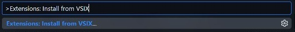
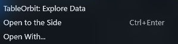

# Install TableOrbit

[Back to TableOrbit](../README.md)

TableOrbit is a desktop VS Code extension. This preview is installed from a `.vsix` file. It is not on the Marketplace.

## Requirements

| Task | Required software |
|---|---|
| Read the demo or import text data | Desktop VS Code 1.85 or later |
| Read Parquet | Python with DuckDB 1.5.3 |
| Draw and export figures | Python with Matplotlib and Seaborn |
| Read XLSX/XLSM, Arrow/Feather or DTA | Python with openpyxl, pyarrow or pandas, respectively |
| Run the agent CLI or browser preview | Node.js 20 or later, plus the packages needed for the task |

The VSIX does not include Python or its packages. The extension uses VS Code's Node runtime. Install a separate Node runtime only for the CLI, browser preview or packaging.

Open file reads ordinary files before asking for panel keys. See [supported formats and limits](OPEN_FILES.md). Examples are available from Quick guide and the explicit demo command.

Windows has a [completed installation test](VSIX_LOCAL_TEST.md). Other operating systems and remote hosts are not yet verified.

## Install the VSIX

Get a VSIX from a maintainer you trust, or follow [Build a VSIX](RELEASE.md#build-a-vsix). There is no Marketplace download for this preview.

1. Open VS Code.
2. Open the Command Palette with **Ctrl+Shift+P**. On macOS, use **Cmd+Shift+P**.
3. Type **Extensions: Install from VSIX...**.
4. Select the `.vsix` file.
5. Reload VS Code if it asks you to.
6. Run **TableOrbit: Explore Data** from the Command Palette and select a file.

The reader shows source records before you choose an index. CSV and JSON work without Python. For a sample, run **TableOrbit: Open Grunfeld Demo**, or choose an example from Quick guide.



If the `code` command is available in your shell, you can install from the package directory instead:

```bash
code --install-extension ./tableorbit-0.2.0.vsix
```

Choose the file you built if its version differs. VS Code documents both methods in its [extension installation guide](https://code.visualstudio.com/docs/configure/extensions/extension-marketplace#_install-from-a-vsix).

## Set up Python readers and figures

Use an existing Python environment, or create one for TableOrbit. The commands below install packages into the environment selected by `python`:

```bash
python -m pip install duckdb==1.5.3
python -m pip install matplotlib seaborn
python -c "import sys, duckdb, matplotlib, seaborn; print(sys.executable); print(duckdb.__version__)"
```

Skip the second command if you do not need figures. In that case, check Python with:

```bash
python -c "import sys, duckdb; print(sys.executable); print(duckdb.__version__)"
```

Install only the additional readers you need in that same Python environment:

```bash
python -m pip install openpyxl  # Excel XLSX and XLSM
python -m pip install pyarrow   # Arrow IPC and Feather
python -m pip install pandas    # Stata DTA
```

1. Copy the Python executable path printed by the check.
2. Open VS Code Settings.
3. Search for `panelSpace.pythonPath`.
4. Paste the full executable path into **Python Path**.
5. Close the TableOrbit reader.
6. Open the reader again.

The setting takes an executable path, not a folder or a shell command. For example, use `C:/tools/tableorbit-env/python.exe` only if that file exists.

An empty setting uses `PANEL_SPACE_PYTHON`, when set, or `python` on PATH. Selecting an interpreter in another Python extension does not set TableOrbit's interpreter.

## Open data from File Explorer

1. Open a folder that contains your data in VS Code.
2. Right-click a supported file in Explorer.
3. Select **TableOrbit: Explore Data**.



Parquet also supports direct opening. If another Parquet extension opens the file, use **Open With... → TableOrbit**. Use **Configure default editor...** in that picker to change future openings.

For multiple Parquet files that form one dataset, right-click the dataset folder. Select **TableOrbit: Open Parquet Dataset Folder**. Subfolders are included. Select a single dataset root, not a parent that contains backups or different versions.

The extension is disabled in Restricted Mode because it runs a local Python process. Review VS Code's Workspace Trust prompt yourself. Trust only folders whose contents you trust.

## Start the agent CLI

1. Run **TableOrbit: Show Agent CLI Command** from the Command Palette.
2. Copy the printed command from the **TableOrbit CLI** Output channel.
3. Run the command in Bash or pass the executable and arguments to your agent.
4. Send the [capabilities request](AGENT_CLI.md#protocol) as one JSON line.

The command points to the installed script. The VSIX does not add `tableorbit` to PATH. Repeat these steps after reinstalling if the extension path changes.

## Solve setup problems

| Symptom | Action |
|---|---|
| No TableOrbit commands | Confirm that the VSIX is installed and enabled in the current profile. Check Workspace Trust. |
| Parquet opens in another viewer | Use **Open With... → TableOrbit**. Check the default editor association. |
| Python cannot start | Check that `panelSpace.pythonPath` points to an executable. Reopen the reader after changing it. |
| `No module named duckdb` | Install DuckDB in the Python environment that TableOrbit uses. |
| Figures fail to render | Check Matplotlib and Seaborn in that same environment. Read the reported error. |
| A text file exceeds 10 MB | Use a Parquet version through the Parquet reader. TableOrbit does not convert the file for you. |
| A folder has incompatible schemas | Select files from one dataset with matching columns and types. Delta tables are not supported. |
| A query times out | Select fewer columns or a narrower time range. The query deadline is 30 seconds. Key checks may still scan many records. |
| Save opens the extension folder | Choose an output folder before saving. This is a known limitation of the preview. |

For a remote VS Code session, Python and data must exist on the extension host. A local Windows path does not refer to a file on a remote Linux host. Remote installation remains untested.

## Update or remove

To update, install the replacement VSIX and run **Developer: Reload Window**. Preview builds can share version 0.2.0. To replace that version from Bash, use:

```bash
code --install-extension ./tableorbit-0.2.0.vsix --force
```

Check the artifact checksum in the [local test record](VSIX_LOCAL_TEST.md) when comparing preview builds. Reloading closes the current TableOrbit sessions, so note any index or filter choices first.

To remove, open the Extensions view. Find **TableOrbit**, then select **Uninstall**. Python environments and source data remain on disk.
